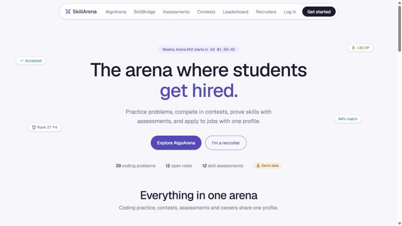
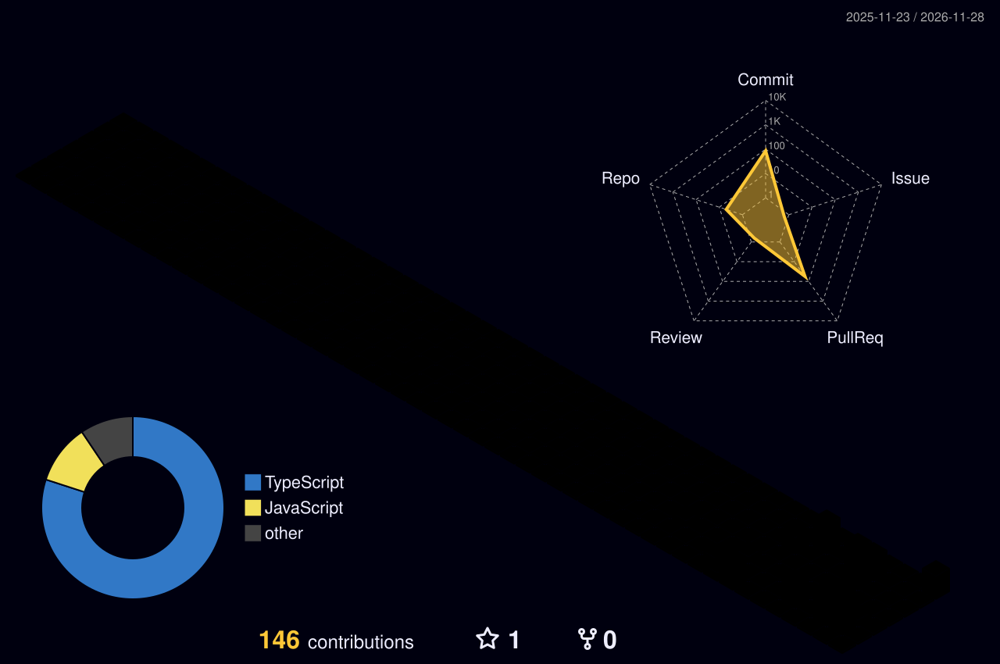

  

  
  

---

### 🚀 About me

<table>
  <tr>
    <td width="55%" valign="middle">

- 🎓 Student developer who loves building full-stack web apps end to end
- 🔭 Currently building [**SkillArena**](https://github.com/Swarnabh06/SKILLARENA): a coding practice, contests and careers platform for college students
- 🌱 Learning more about system design, testing and shipping production-ready apps
- ⚡ I enjoy turning real problems (study habits, local shops, disaster alerts) into working software

    </td>
    <td width="45%" align="center" valign="middle">
      
    </td>
  </tr>
</table>

### 🛠️ Tech stack

  

---

### 🏟️ Spotlight: SkillArena

> **Learn. Code. Compete. Get Hired.** One platform for college students.

- 💻 **AlgoArena**: 39 coding problems, an in-browser editor (Python, Java, C++, JS), daily challenges and judged submissions
- 🏆 **Contests**: live standings, auto-scheduled weekly rounds, a Codeforces / LeetCode / CodeChef calendar
- 📝 **Assessments**: timed skill tests that verify skills on your profile
- 💼 **SkillBridge**: jobs and internships with a match score for every student
- 🧑‍💼 **Recruiter portal and admin console**, XP, levels, streaks and badges

Built with Next.js 16, React 19, Tailwind CSS 4, MongoDB and Better Auth.

### 📌 Featured projects

  
  

  
  

More projects: [Hotel Management System](https://github.com/Swarnabh06/Hotel-Mnagement-System) · [Library Management System](https://github.com/Swarnabh06/OOPS-PROJECT) · [Agarwal Online (live)](https://agarwal-online.vercel.app)

---

### 📊 GitHub stats

  
  

  

  
  

  
<b>📈 Full GitHub metrics</b> (click to expand)

   
  

    
  

### 🏙️ 3D contributions

  

### 🔥 Contributions

<picture>
  <source media="(prefers-color-scheme: dark)" srcset="https://raw.githubusercontent.com/Swarnabh06/Swarnabh06/output/github-snake-dark.svg" />
  <source media="(prefers-color-scheme: light)" srcset="https://raw.githubusercontent.com/Swarnabh06/Swarnabh06/output/github-snake.svg" />
  
</picture>

  

  

### ⚡ Recent activity

<!--START_SECTION:activity-->
1. 🎉 Merged PR [#56](https://github.com/Shriram-Traders/AgarwalOnline/pull/56) in [Shriram-Traders/AgarwalOnline](https://github.com/Shriram-Traders/AgarwalOnline)
2. 💪 Opened PR [#56](https://github.com/Shriram-Traders/AgarwalOnline/pull/56) in [Shriram-Traders/AgarwalOnline](https://github.com/Shriram-Traders/AgarwalOnline)
3. 🎉 Merged PR [#55](https://github.com/Shriram-Traders/AgarwalOnline/pull/55) in [Shriram-Traders/AgarwalOnline](https://github.com/Shriram-Traders/AgarwalOnline)
4. 💪 Opened PR [#55](https://github.com/Shriram-Traders/AgarwalOnline/pull/55) in [Shriram-Traders/AgarwalOnline](https://github.com/Shriram-Traders/AgarwalOnline)
5. 🎉 Merged PR [#54](https://github.com/Shriram-Traders/AgarwalOnline/pull/54) in [Shriram-Traders/AgarwalOnline](https://github.com/Shriram-Traders/AgarwalOnline)
<!--END_SECTION:activity-->

---

  
<b>🎓 Education</b>

   
  <!-- TODO: add your college, degree and graduation year -->
  Student developer building full-stack projects.

  
<b>🏆 Achievements</b>

   
  <!-- TODO: add hackathons, contest ranks and certificates -->
  Built and shipped SkillArena: 39 problems, contests, assessments and a job board on one platform.

  
<b>📫 Reach me</b>

   
  <!-- TODO: add LinkedIn / email / portfolio badges here -->
  Open an issue or say hi on any of my repos: <a href="https://github.com/Swarnabh06">github.com/Swarnabh06</a>

<i>Thanks for stopping by! ⭐ a repo if you like it.</i>

